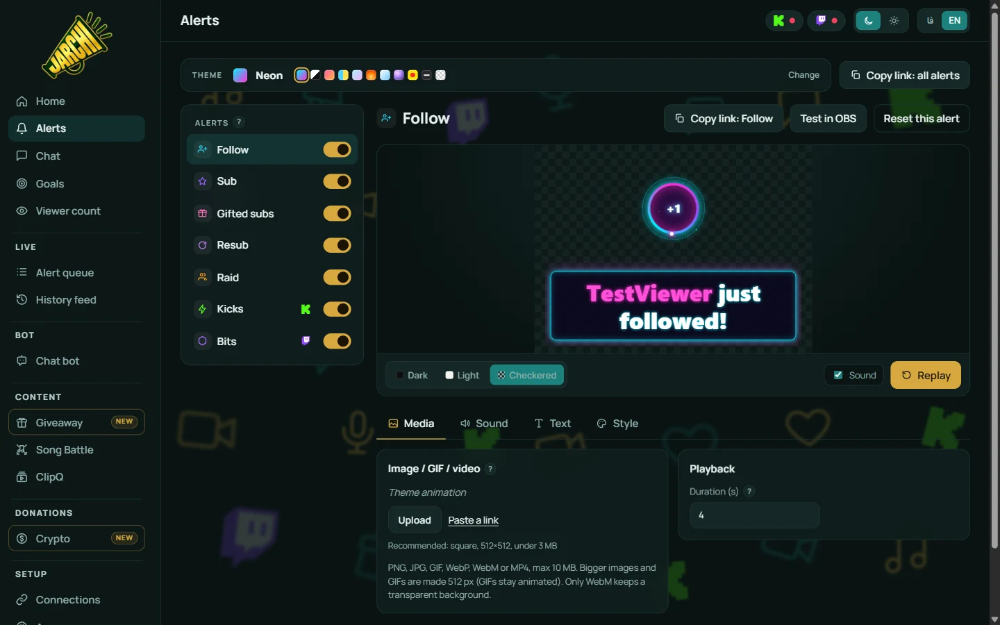
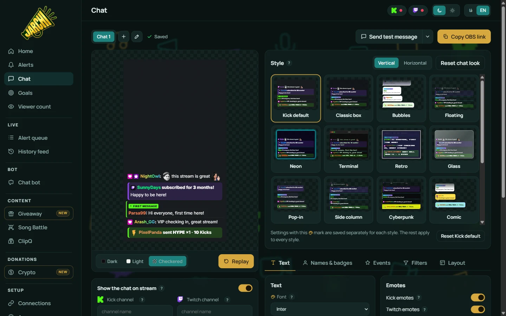
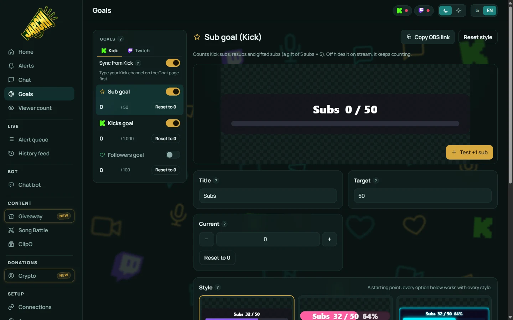

<div align="center">


### Stream alerts, chat and goals for OBS.<br>Running on your own PC.

No account. No central server. Just your Kick and Twitch channel names.

<br>

<a href="https://github.com/MamadPoker/Jarchi/releases/latest/download/Jarchi-Setup.exe"></a>

<br><br>

[](https://github.com/MamadPoker/Jarchi/releases/latest)
[](https://github.com/MamadPoker/Jarchi/actions/workflows/ci.yml)
[](https://github.com/MamadPoker/Jarchi/actions/workflows/security.yml)
[](docs/alerts.md#real-kick-alerts-no-login)
[](docs/alerts.md#real-twitch-alerts-no-login)
[](LICENSE)



</div>

<br>

## Why Jarchi

<table>
<tr>
<td width="50%" valign="top">

**Alerts that feel alive**<br>
11 themes with their own animations and sounds, a live preview that plays exactly what OBS will show, and bigger events that feel bigger. [Alerts →](docs/alerts.md)

</td>
<td width="50%" valign="top">

**Real Kick and Twitch alerts, no login**<br>
Subs, gifts, Kicks, bits and raids straight from your channels' public chat. One queue, never two alerts at once. [How it works →](docs/alerts.md#real-kick-alerts-no-login)

</td>
</tr>
<tr>
<td valign="top">

**Chat in one box**<br>
Kick and Twitch together, 27 styles, Kick, Twitch and 7TV emotes, the platforms' own badges. [Chat →](docs/chat.md)

</td>
<td valign="top">

**Goals that move by themselves**<br>
Six goal widgets that sync from your Kick and Twitch channels and celebrate when they're reached. [Goals →](docs/goals.md)

</td>
</tr>
<tr>
<td valign="top">

**Crypto donations**<br>
USDT (BEP20, TRC20) straight to your own wallet through Jarchi Pay, played in the same alert queue. [Crypto →](docs/crypto.md)

</td>
<td valign="top">

**Yours, on your PC**<br>
A desktop app with a tray icon and quiet updates, a Persian right-to-left panel, and your own VPN found for you. [The panel →](docs/panel.md)

</td>
</tr>
</table>

<div align="center">


</div>

## Quick start

1. **Install**: [download Jarchi for Windows](https://github.com/MamadPoker/Jarchi/releases/latest/download/Jarchi-Setup.exe), or run it from source with [Node.js](https://nodejs.org/) 20.18.1+:
   ```sh
   npm install
   npm start   # or: npm run app, for the desktop window
   ```
2. **Open the panel** at **http://127.0.0.1:3000** and type your Kick and Twitch channel names on the **Chat** page.
3. **Add it to OBS**: **Sources → + → Browser**, paste the link from **Copy OBS link** on the **Alerts** page, size **800 × 600**, tick **Control audio via OBS**. Press **Test in OBS**.

> [!TIP]
> Start Jarchi before OBS. If OBS was first, right-click the source and choose **Refresh**. [Full guide →](docs/getting-started.md)

## Docs

| | |
|---|---|
| [Getting started](docs/getting-started.md) | Install, run, add to OBS |
| [The panel](docs/panel.md) | Every page, and the Persian panel |
| [Alerts](docs/alerts.md) | Themes, media, real Kick and Twitch alerts, the queue |
| [Chat](docs/chat.md) | Styles, emotes, badges, profile pictures |
| [Goals](docs/goals.md) | Six goals and Sync from Kick / Twitch |
| [Crypto donations](docs/crypto.md) | Jarchi Pay and its alerts |
| [Proxy & VPN](docs/proxy.md) | VPNs and filtered networks |
| [Development](docs/development.md) | Project layout, event shape, tests |
| [Releasing](docs/releasing.md) | PR rules, installer, updates |

<br>

<div align="center">
<sub>Made for streamers · <a href="LICENSE">MIT License</a> · <a href="https://github.com/MamadPoker/Jarchi/releases/latest">Latest release</a></sub>
</div>
